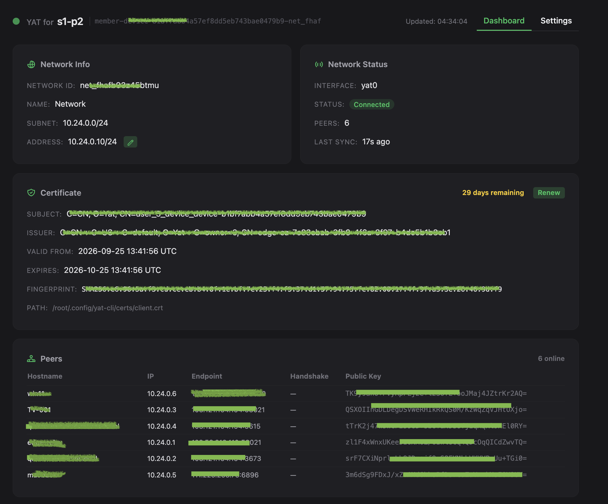
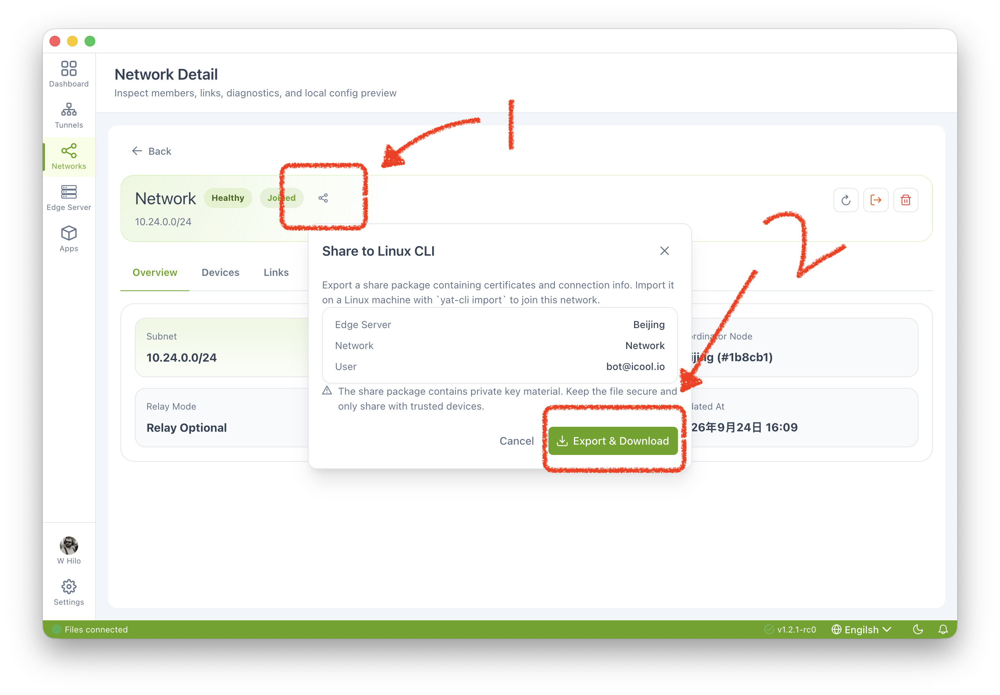
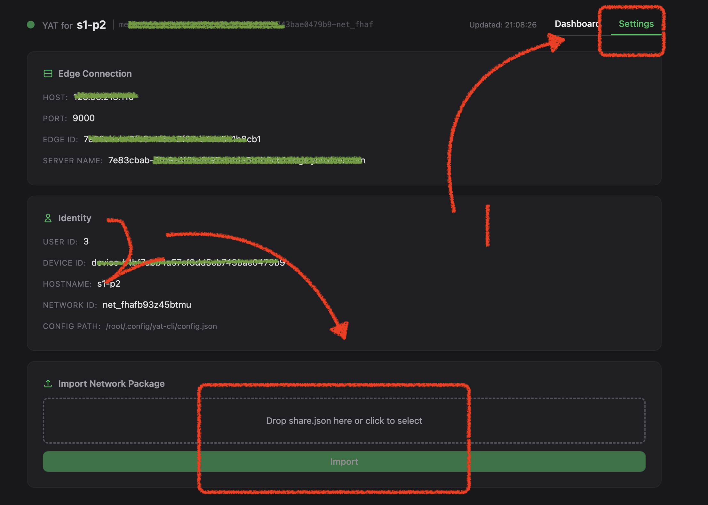

> ###  [English](README.md) | [中文](README_ZH.md) | 日本語

# yat-fe-linux
Yat client for linux


YAT Linux クライアント（`yat-client`）は、YAT プラットフォームのネイティブ Linux クライアントです。WireGuard ネットワーキング機能と、管理用の組み込み Web ダッシュボードを提供します。Docker イメージは amd64、arm64、armv7 に対応しており、スタンドアロンバイナリは amd64 と arm64 が提供されています。

---

## クイックスタート

3 ステップで Linux マシンを YAT WireGuard ネットワークに接続できます：

```bash
# 1. クライアントを起動（Docker）
docker run -d --name yat-client \
  --cap-add NET_ADMIN \
  --device /dev/net/tun \
  --net host \
  ghcr.io/tunnel6/yat-client-linux:latest yat-client serve

# 2. ブラウザでダッシュボードを開く
#    http://<your-linux-ip>:9909

# 3. 設定タブで share.json をアップロード — クライアントは自動的に接続します
```



> **ヒント**: デスクトップアプリ（macOS/Windows）で `share.json` をエクスポートし、ダッシュボードまたは CLI からインポートしてください。

## ネットワーク設定のエクスポート

デスクトップアプリで **ネットワーク** → **詳細** → **CLI 用に共有** を開いて `share.json` をエクスポートし、そのファイルを Linux クライアントにインポートします。



---

## 動作要件

| 項目 | 要件 |
|------|-------------|
| **OS** | Linux（x86_64 / aarch64 / armv7） |
| **カーネル** | ホストカーネルが WireGuard に対応している必要があります。組み込みでない、または自動的に読み込まれない場合は、ホストで `wireguard` モジュールを読み込んでください |
| **Docker** | Docker 20.10+（Docker で実行する場合） |
| **権限** | `root` または `CAP_NET_ADMIN`（WireGuard インターフェースの作成に必要） |
| **ネットワーク** | 接続可能な YAT Edge サーバー（ポートは Edge の設定により決定） |
| **メモリ** | 最低 64 MB の空きメモリ |

### Docker の追加権限

`wireguard` カーネルモジュールはコンテナイメージではなくホスト側に属します。ホストカーネルに組み込まれていない、または自動的に読み込まれない場合は、コンテナの起動前にホストで読み込んでください：

```bash
sudo modprobe wireguard
```

```bash
# TUN インターフェースとルート設定に必要な Docker 権限
--cap-add NET_ADMIN \
--device /dev/net/tun
```

---

## クライアントの実行

### オプション 1：Docker（推奨）

#### イメージの取得

```bash
# GitHub Container Registry から取得（amd64 / arm64 / arm/v7 対応）
docker pull ghcr.io/tunnel6/yat-client-linux:latest
```

汎用タグの `1.0.0` と `latest` には amd64、arm64、arm/v7 のイメージが含まれています。`latest` は現在 `1.0.0` を指しています。Docker はホストのアーキテクチャに一致するイメージを自動的に選択するため、これらの汎用タグは Raspberry Pi デバイスに推奨されます。

| タグ | アーキテクチャ | ユースケース |
|-----|--------------|----------|
| `1.0.0`, `latest` | amd64, arm64, arm/v7 | 推奨。Docker が一致するアーキテクチャを選択 |
| `amd64-1.0.0` | amd64（x86_64） | x86_64 ホスト |
| `arm64-1.0.0` | arm64（aarch64） | 64-bit ARM システム |
| `arm-1.0.0` | arm/v7（armv7） | 32-bit ARMv7 システム |

Raspberry Pi デバイスについて、初期の Raspberry Pi 2 Model B（revision 1.1）は ARMv7 を使用しているため、アーキテクチャ別タグを選ぶ場合は `arm-1.0.0` を使用してください。後期型の Pi 2 と Raspberry Pi 3 は Armv8 対応プロセッサを搭載していますが、イメージのアーキテクチャはインストールされている OS に依存します。Raspberry Pi 3 が必ずしも `arm-1.0.0` を必要とするわけではありません。ホストで `uname -m` を実行して確認してください：`armv7l` は `arm-1.0.0`、`aarch64` は `arm64-1.0.0` に対応します。`1.0.0` または `latest` を使用する場合は、手動での選択は不要です。

参考：[Raspberry Pi BCM2836 ドキュメント](https://github.com/raspberrypi/documentation/blob/master/documentation/asciidoc/computers/processors/bcm2836.adoc) および [BCM2837 ドキュメント](https://github.com/raspberrypi/documentation/blob/master/documentation/asciidoc/computers/processors/bcm2837.adoc)。

#### コンテナの起動

```bash
# WireGuard トンネルのルーティングにはホストネットワークモードが必要です（ダッシュボードのデフォルトポート：9909）
docker run -d --name yat-client \
  --cap-add NET_ADMIN \
  --device /dev/net/tun \
  --net host \
  ghcr.io/tunnel6/yat-client-linux:latest yat-client serve
```

#### カスタムポート

```bash
# Web UI の待ち受けポートを変更
docker run -d --name yat-client \
  --cap-add NET_ADMIN \
  --device /dev/net/tun \
  --net host \
  ghcr.io/tunnel6/yat-client-linux:latest \
  yat-client serve --listen=0.0.0.0:8080

# または環境変数で待ち受けアドレスを設定
docker run -d --name yat-client \
  --cap-add NET_ADMIN \
  --device /dev/net/tun \
  --net host \
  -e YAT_LISTEN=0.0.0.0:8080 \
  ghcr.io/tunnel6/yat-client-linux:latest yat-client serve
```

#### 設定の永続化

```bash
# 設定ディレクトリをマウントして、コンテナ再起動後も設定を維持
docker run -d --name yat-client \
  --cap-add NET_ADMIN \
  --device /dev/net/tun \
  --net host \
  -v ~/.config/yat-cli:/root/.config/yat-cli \
  ghcr.io/tunnel6/yat-client-linux:latest yat-client serve
```

#### ログの確認

```bash
docker logs -f yat-client
```

---

### オプション 2：CLI バイナリ

#### バイナリのダウンロード

```bash
# お使いのアーキテクチャ向けのバイナリをダウンロード（x86_64 の例）
chmod +x yat-client
```

#### CLI コマンドリファレンス

| コマンド | 説明 |
|---------|-------------|
| `yat-client import <share.json>` | ネットワーク設定パッケージをインポート |
| `yat-client serve [--listen ADDR]` | Web ダッシュボード付きデーモンを起動 |
| `yat-client start` | フォアグラウンド接続モード（Web UI なし） |
| `yat-client status` | 現在のネットワーク状態を表示 |
| `yat-client leave` | ネットワークから退出し、WireGuard インターフェースを破棄 |
| `yat-client cert-info` | 証明書情報を表示 |

#### 一般的なワークフロー

```bash
# 1. ネットワーク設定をインポート（デスクトップアプリでエクスポートした share.json）
sudo yat-client import share.json

# 2. デーモンを起動（デフォルト待ち受け：0.0.0.0:9909）
sudo yat-client serve

# またはカスタム待ち受けアドレスを指定
sudo yat-client serve --listen 0.0.0.0:8080

# 3. ブラウザでダッシュボードを開く
#    http://<your-linux-ip>:9909
```

> **注意**: `import` と `serve` コマンドは WireGuard ネットワークインターフェースの作成に root 権限が必要です。

#### フォアグラウンドモード（Web UI なし）

```bash
# スクリプトや一時的な使用に適しています
sudo yat-client start
# Ctrl+C で接続を解除
```

#### 状態の確認

```bash
sudo yat-client status
```

出力例：

```
Network:    net-xxxxxxxxxxxx
Member:     member-xxxxxxxx
Interface:  yat0 (kernel)
Address:    10.0.0.5
Peers:      3
Connected:  yes

── WireGuard Engine ──
Backend:    wireguard
Interface:  yat0 (kernel)
Address:    10.0.0.5
Public key: abcdef1234567890...
Peers:      3

── Live Stats ──
Backend:    wireguard (yat0)
Peers:      3
  [server-a] ep=1.2.3.4:51820 rx=12.3MB tx=5.6MB
  [server-b] ep=5.6.7.8:51820 rx=8.1MB tx=3.2MB
  [server-c] ep=relay.yat.io:443 rx=0.5MB tx=0.3MB
```

---

## Web ダッシュボードガイド

`serve` コマンドを起動すると、ブラウザで多機能な Web ダッシュボードが利用できます。

### ダッシュボードタブ

- **ネットワーク情報** — ネットワーク ID、メンバー ID、割り当てられた IP アドレス、インターフェース名などの基本情報を表示
- **ネットワーク状態** — リアルタイムの接続状態、オンラインピア数、最終同期タイムスタンプ
- **ピア** — ホスト名、IP アドレス、エンドポイント、RX/TX トラフィック統計を含むピア一覧
- **証明書** — 証明書の詳細（Subject / Issuer / 有効期間 / フィンガープリント）とワンクリックでの更新
- **最新ログ** — 直近 50 件のランタイムログを重大度別（INFO / WARN / ERROR）の色分けで表示

### 設定タブ

- **Edge 接続** — Edge サーバーのホスト、ポート、Edge ID を表示
- **ID** — ユーザー ID、デバイス ID、ホスト名を表示
- **インポート** — Linux エージェントのダッシュボード（例：`http://<linux-agent-ip>:9909`）を開き、設定ページ下部のインポート控件で `share.json` をアップロードします。インポート後、サービスは自動的に再起動されます


- **再接続** — Edge の再接続を手動でトリガー（切断時に有効）
- **アドレス更新** — このデバイスのネットワーク内 IP アドレスを動的に変更

### ダッシュボードの特徴

- YAT グリーンアクセント（#22c55e）を備えたダークテーマ
- 5 秒ごとに状態データを自動リフレッシュ
- ゼロコンフィグ起動 — まずダッシュボードを起動し、Web UI から設定をインポート
- 自動証明書監視 — 毎時チェックし、有効期限が近づくと自動更新（OAuth 資格情報が必要）
- 切断時の自動再接続 — 指数バックオフ戦略で最大 10 回リトライし、失敗後は 30 分のクールダウンに入ります

---

## 設定

設定ファイルは `~/.config/yat-cli/` に保存されます：

```
~/.config/yat-cli/
├── config.json          # 主設定（Edge 接続 + ID 情報）
├── device-id            # ローカルデバイス ID（再インポート後も安定）
├── device-identity.json # デバイス ID（WG キーペアと関連付け）
└── certs/
    ├── ca.crt           # CA 証明書
    ├── captain-ca.crt   # Captain CA 証明書
    ├── client.crt       # クライアント証明書
    └── client.key       # クライアント秘密鍵
```

---

## リリースノート

### v1.0.0

| libc | アーキテクチャ | ベースイメージ | プラットフォーム |
|------|--------------|------------|----------|
| musl | amd64 | `alpine:3.20-amd64` | `linux/amd64` |
| musl | arm64 | `alpine:3.20-arm64` | `linux/arm64` |
| GNU | amd64 | `debian:bookworm-slim-amd64` | `linux/amd64` |
| GNU | arm64 | `debian:bookworm-slim-arm64` | `linux/arm64` |
| GNU | armv7 | `debian:bookworm-slim-armv7` | `linux/arm/v7` |

## アーキテクチャ対応状況

| アーキテクチャ | Docker イメージ | バイナリ |
|-------------|-------------|--------|
| linux/amd64 (x86_64) | ✅ | ✅ |
| linux/arm64 (aarch64) | ✅ | ✅ |
| linux/arm/v7 (armv7) | ✅ | 未提供 |

イメージバリアントは Alpine 3.20（musl libc）または Debian Bookworm slim（GNU libc）を使用しています。

---

## FAQ

**Q: なぜ root 権限が必要なのですか？**  
A: WireGuard は TUN ネットワークインターフェースの作成とルート設定が必要であり、カーネルレベルのネットワーク管理権限が要求されるためです。

**Q: コンテナ再起動後に設定が失われました？**  
A: `-v ~/.config/yat-cli:/root/.config/yat-cli` で永続ボリュームをマウントしてください。

**Q: 証明書が期限切れになった場合は？**  
A: `share.json`（OAuth 資格情報含む）でインポートした場合はシステムが自動更新します。それ以外の場合、デスクトップアプリから再エクスポートして再インポートしてください。

**Q: バックグラウンドで実行するには？**  
A: Docker（`docker run -d`）を使用するか、`nohup sudo yat-client serve &` を実行します。systemd サービスユニットを作成することもできます。
